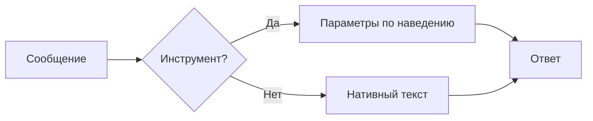
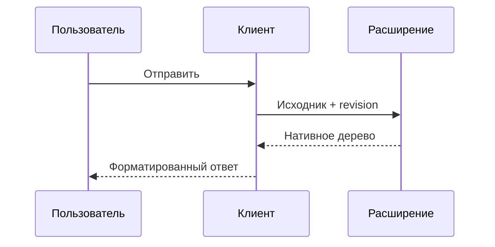

# Нативный форматированный ответ

Выделите слово **Кириллица**, нажмите ПКМ и скопируйте его. Здесь также есть
*курсив*, ~~зачёркивание~~, `inline code` и [пример ссылки](https://example.com).

- первый пункт
- второй пункт

1. последовательность
2. продолжение

- [ ] ещё не сделано
- [x] готово

| Показатель | Значение |
| :-- | --: |
| RSS | 256 МиБ |
| PSS | 172 МиБ |

> Цитата с **выделением** и несколькими словами.

```rust
fn main() {
    let values = [1, 2, 3, 4];
    for value in values {
        println!("Синтетический пример: {value}");
    }
}
```

## Mermaid: поток



## Mermaid: последовательность



## JSON-каталог

```json-render
{"type":"card","title":"Синтетический отчёт","children":[{"type":"metric","label":"Сообщений","value":"50 000"},{"type":"table","columns":["Проверка","Результат"],"rows":[["Кириллица","Готово"],["Без браузера","Да"]]}]}
```

Неизвестный язык остаётся обычным кодом:

```unknown-fixture
строка один
строка два
```

Последний абзац: ниже него не должно появляться дополнительное место для прокрутки.
