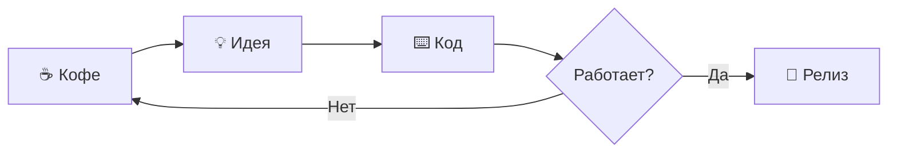
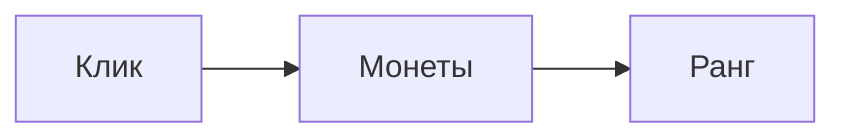

## 🌌 Немного космоса

> Где-то между первым кликом и тысячной монетой  
> обычный игрок становится легендой.

### Формула настроения

$$
\text{Настроение} =
\frac{\text{кофе} + \text{интересные задачи}}
{1 + \text{количество багов}}
$$

### Маленькая история



### Панель состояния

| Система | Состояние |
|---|---|
| Воображение | 🟢 Работает |
| Запас печенек | 🟡 Заканчивается |
| Неожиданные баги | 🔴 Уже в пути |

- [x] Придумать идею
- [x] Написать красивый текст
- [ ] Не отвлечься на новую идею

---

И напоследок — **жирный**, *курсивный*, ~~ненужный~~ и `очень технический` текст.

### Проверка блока кода

```rust
fn main() {
    let values = [1, 2, 3, 4];
    for value in values {
        println!("Синтетический пример: {value}");
    }
}
```

Проверка `очень технический` рядом с обычным текстом.

### Исходник и результат

```md
| Игрок | Монеты |
|---|---|
| Аня | 100 |
| Боб | 50 |
```

| Игрок | Монеты |
|---|---|
| Аня | 100 |
| Боб | 50 |

````md

````


### Формулы внутри строки и эмодзи

Энергия $E=mc^2$, дробь $\frac{a}{b}$, корень $\sqrt{x}$ и индекс $x_1$ остаются в строке.
**Жирный $x^2$**, *курсив $\alpha+\beta$* и [ссылка $y_1$](https://example.com).

| Формула | Проверка |
|---|---|
| $\frac{1}{2}$ | ☕ 💡 🚀 🌌 |
| $x_1$ | 🟢 🟡 🔴 |

- Формула $x^2$ в списке.
- Буквальные `\$`, `$x$` и \$x\$; цены $100 и $20.

```text
$x$ — исходник, без номеров строк.
```

```
Обычный текст ☕ 🚀, без номеров строк.
```
